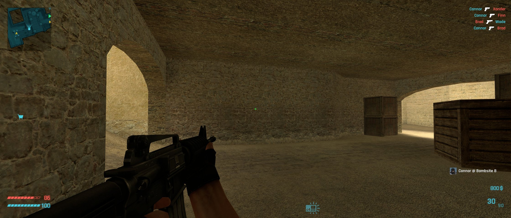
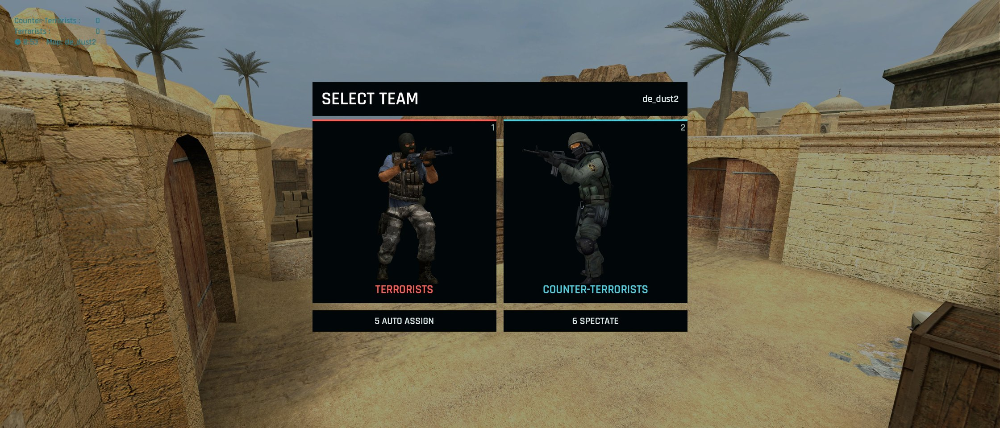
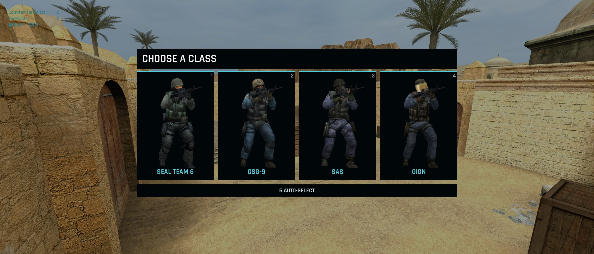
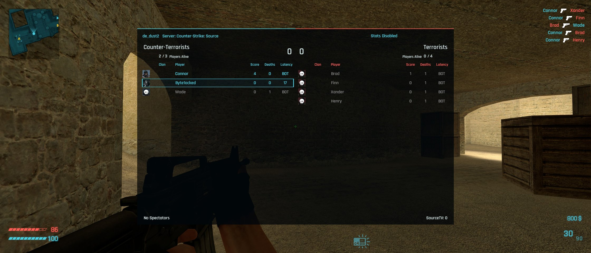
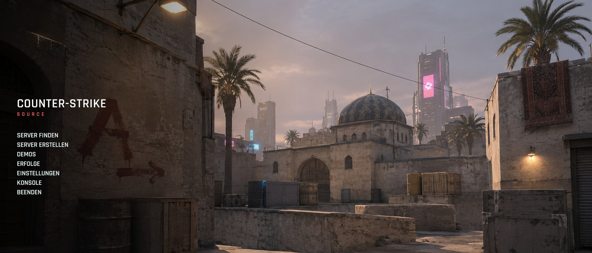
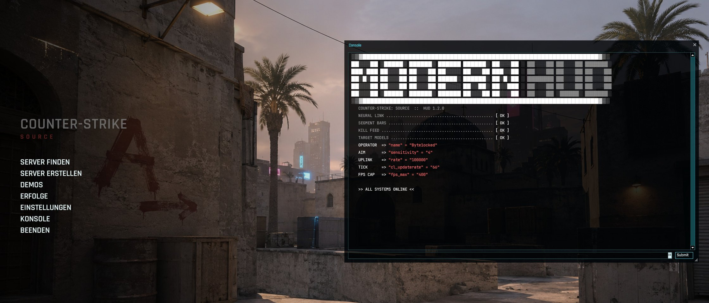
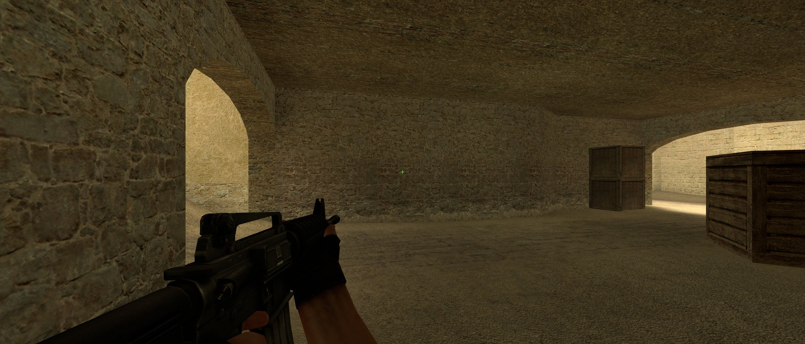

# Modern HUD für Counter-Strike: Source

Ein neuer Look für CS:S: HUD, Menüs, Team- und Klassenwahl, Scoreboard, Konsole und Menü-Hintergrund.
Koralle und Cyan, Rajdhani als Schrift, schräge Segment-Balken mit weichem Glow, wenige Elemente.

## Download

**[ModernHUD-Setup.exe herunterladen](https://github.com/byte1ocked/ModernHUD/releases/latest/download/ModernHUD-Setup.exe)**

Für Windows, sonst braucht es nichts. Alle Versionen stehen unter [Releases](https://github.com/byte1ocked/ModernHUD/releases).

## Installieren

1. `ModernHUD-Setup.exe` starten. Zeigt Windows „Der Computer wurde durch Windows geschützt“: auf
   **Weitere Informationen**, dann **Trotzdem ausführen** klicken. Das Programm ist nicht bei Microsoft
   registriert, deshalb die Warnung.
2. CS:S schließen und **INSTALL** klicken.
3. Spielen.

Der Installer findet das Spiel selbst, auch in anderen Steam-Bibliotheken. Menü-Hintergrund und
Konsolenschrift passt er an deine Auflösung an. Ein anderes HUD und deine bisherigen Einstellungen
sichert er, bei der Deinstallation kommt beides unverändert zurück.

## Surf-Modus

Ein Schalter im Installer, für Surf- und Bhop-Server: ohne Leben, Rüstung, Munition, Geld, Timer, Radar,
die Icons für Bombe, Defuser und Kaufzone und ohne den Block mit Teams, Uhr und Geld oben links.
Umschalten heißt: Installer starten, Schalter umlegen, **APPLY**.

## Updates

Nach der Installation läuft ein kleiner Updater im Hintergrund, er startet mit Windows. Etwa einmal pro
Minute fragt er bei GitHub nach einer neuen Version und installiert sie, sobald CS:S geschlossen ist.
Dabei sieht GitHub deine IP-Adresse. Jede Version ist signiert, eine Datei ohne passende Signatur
installiert der Updater nicht. Hast du statt Modern HUD ein anderes HUD eingebaut, lässt er das HUD in Ruhe.

## Eigene cfgs

Wer von uns eigene cfgs bekommt, erhält dafür einmal einen Code. Der Installer begrüßt dich mit deinem
Steam-Namen und fragt nach dem Code. Danach kommen Änderungen an deinen cfgs von allein an und sind
ab dem nächsten Spielstart aktiv.

Die cfgs liegen hier verschlüsselt, ohne den Code kann sie niemand lesen. Auf deinem PC landen sie in
`cstrike\custom\modernhud_player`, deine eigenen Dateien in `cstrike\cfg` bleiben unberührt.

## Server mit sv_pure

Auf Servern mit `sv_pure 1` oder `2` lädt das Spiel keine eigenen Texturen. Schriften, Farben und
Layout bleiben, einige Grafiken wie die Kill-Icons fallen auf das Original zurück oder fehlen.

## Deinstallieren

Windows-Einstellungen, **Apps**, „Modern HUD for Counter-Strike: Source“, **Deinstallieren**. HUD,
Updater und cfgs sind dann weg, ein vorher installiertes HUD und deine Einstellungen kommen zurück.
CS:S startet dafür einmal kurz und schließt sich wieder.

## Lizenzen

- Rajdhani und JetBrains Mono: SIL Open Font License
- Phosphor Icons: MIT
- Die Waffen-Icons und Kartengrafiken stammen aus Counter-Strike: Source und gehören Valve. Modern HUD
  ist kein Produkt von Valve.
